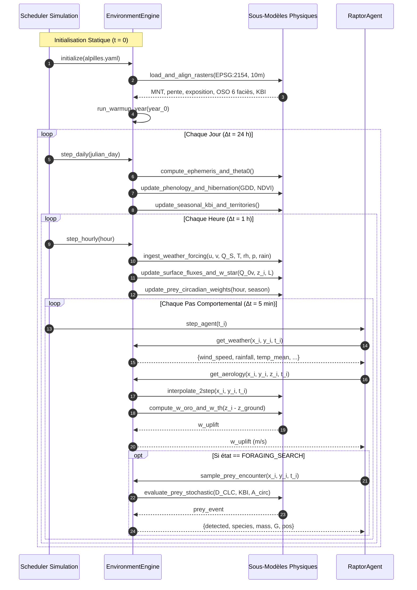

---
tags:
  - ibm
  - odd
  - bonelli
  - environment
  - scheduling
  - interpolation
type: odd-spec
status: draft
---

# ODD Environnement — Dynamique Temporelle et Planification

Cette note décrit l'ordonnancement multi-échelle du moteur environnemental, depuis l'initialisation statique des rasters jusqu'aux requêtes sous-horaires de vol à $\Delta t = 5\text{ min}$. Elle détaille également l'algorithme d'interpolation spatio-temporelle en deux étapes permettant d'évaluer des champs continus aux coordonnées $(x, y, z, t)$ de l'agent.

> **Liens internes :** [[ODD_Env_Grilles_et_Parametres_Alpilles]] | [[ODD_Env_Sous_Modeles_Physiques]] | [[Interface_Requise_Environnement]]

---

## 1. Ordonnancement Temporel Multi-Échelle (*Scheduling*)

Le moteur environnemental synchronise quatre pas de temps emboîtés, inspirés des architectures *Persefone* / *ALMaSS* et *Movebank Env-DATA* :

1. **Initialisation statique ($t = 0$) :**
   * Chargement et recalage spatial (`EPSG:2154`, grille $10\text{ m}$) du MNT ($z_{\text{terrain}}$), des dérivées topographiques ($\beta_{\text{slope}}$, $\alpha_{\text{aspect}}$, rugosité) et de la carte OSO Theia.
   * Assignation des constantes biophysiques par faciès ($\alpha$, $z_0$, $d_0$, $\mu$, densité de perchoirs) et chargement des coordonnées des sites de nidification naturels (`nest_sites`) ainsi que des masques territoriaux voisins (`neighbor_k95_mask`).
   * Exécution d'une année de chauffe (`year 0`) pour stabiliser les états initiaux de végétation.
2. **Mise à jour journalière ($\Delta t = 24\text{ h}$) :**
   * Incrémentation du jour julien (`julian_day`) et calcul des éphémérides solaires (`t_sunrise`, `t_sunset`).
   * Mise à jour de la phénologie végétale : accumulation des degrés-jours (`GDD`), hauteur de végétation $h_{\text{veg}}$, ouverture du couvert (`shrub_cover_20m`), indice de détectabilité $D_{\text{CLC}}$ et état d'hivernation des proies ectothermes (*Timon lepidus*).
   * Mise à jour saisonnière (3 périodes : `Br` mars, `Pfdp` juin, `NBr` novembre) de l'indice kilométrique de biomasse `kbi_biomass` et application des transitions pluriannuelles (fermeture par *Pinus halepensis* ou réouverture par incendie naturel au changement d'année).
   * Calcul de la température potentielle de surface moyenne diurne $\theta_0$ ($\text{K}$) entre le lever ($j=1$) et le coucher ($j=n$) du soleil :
     $$\theta_0 = \frac{1}{n} \sum_{j=1}^{n} \left( T_{s,j} + 273.15 \right) \left( \frac{p_0}{p_j} \right)^{0.286}$$
3. **Mise à jour horaire ($\Delta t = 1\text{ h}$) :**
   * Actualisation des champs météorologiques synoptiques : vecteur vent horizontal $\vec{V}_h = (u, v)$, rayonnement net de surface $Q_S$, température de l'air $T$, humidité relative $rh$, pression $p$, précipitations `rainfall`, et hauteur de la couche limite convective $z_i$.
   * Évaluation du régime de Mistral (test du seuil de coupure $V_{\text{surface}} > 12.87\text{ m}\cdot\text{s}^{-1}$), recalcul des flux de surface ($Q_G$, $Q_H$, $Q_0$, $Q_{0v}$), de la vitesse convective de Deardorff $w^*$ et de la longueur de Monin-Obukhov $L$.
   * Actualisation des coefficients d'activité circadienne horaire $A_{\text{circ}}(s, h_{\text{solar}})$ pour chaque guilde de proies.
4. **Pas de temps comportemental et aérologique ($\Delta t = 5\text{ min}$) :**
   * Réponse aux requêtes ponctuelles de `RaptorAgent` aux coordonnées continues $(x_i, y_i, z_i, t_i)$ : interpolation des champs horaires, évaluation instantanée de la vitesse verticale totale $w_{\text{uplift}} = w_{\text{oro}} + w_{\text{th}}$ à la hauteur $h_{\text{AGL}} = z_i - z_{\text{terrain}}(x_i, y_i)$, et tirage stochastique de rencontre de proie en phase `FORAGING_SEARCH`.

### Diagramme de Séquence Multi-Échelle

---

## 2. Algorithme d'Interpolation Spatio-Temporelle en 2 Étapes

Pour évaluer toute variable environnementale $V$ aux coordonnées continues $(x_i, y_i, t_i)$ d'un agent sans introduire d'artefacts de grille, le moteur applique séquentiellement la procédure **Movebank `Env-DATA`** :

1. **Étape 0 — Reprojection de requête :** Si la couche cible possède un CRS natif distinct de `EPSG:2154`, $(x_i, y_i)$ est projeté dans le CRS de la grille source.
2. **Étape 1 — Interpolation spatiale aux deux pas de temps encadrants ($t$ et $t'$) :**
   * Identification des pas de temps disponibles immédiatement antérieur $t \le t_i$ et postérieur $t' \ge t_i$.
   * Extraction des pixels voisins autour de $(x_i, y_i)$ à l'instant $t$ pour calculer $V(x_i, y_i, t)$, puis répétition exacte à l'instant $t'$ pour obtenir $V(x_i, y_i, t')$ :
     * **Variables catégorielles** (faciès OSO Theia, masque d'eau) : **plus proche voisin** (*Nearest Neighbor*).
     * **Variables continues** ($z_{\text{terrain}}$, météorologie, `NDVI`) : **interpolation bilinéaire** sur grille régulière (ou pondération inverse à la distance spatiale).
3. **Étape 2 — Interpolation temporelle à l'instant continu $t_i$ :**
   * Combinaison linéaire par pondération inverse à la distance temporelle (IWD avec exposant $p = 1$) entre les deux estimations spatiales :
     $$V(x_i, y_i, t_i) = \frac{w_t \, V(x_i, y_i, t) + w_{t'} \, V(x_i, y_i, t')}{w_t + w_{t'}}$$
     avec $w_t = |t_i - t|^{-1}$ et $w_{t'} = |t' - t_i|^{-1}$ (si $t_i = t$, $V(x_i, y_i, t_i) = V(x_i, y_i, t)$).
   * *Dimension verticale :* La hauteur au-dessus du sol $h_{\text{AGL}} = z_i - z_{\text{terrain}}(x_i, y_i)$ n'est pas interpolée sur une grille 3D mais injectée directement dans les profils analytiques de couche limite ($U(z)$ et $w_{\text{th}}(z/z_i)$).

---

## 3. Mise à Jour des États Environnementaux et Séries Satellitaires

* **Reconstitution de séries temporelles sans lacunes (*Gapfilling* OSO Theia) :** Les réflectances de surface optiques masquées pour les nuages ou ombres sont reconstruites par interpolation linéaire temporelle entre la date valide précédente et la date valide suivante **avant** le calcul des indices `NDVI` et `NDWI`, permettant un rééchantillonnage sur une grille journalière continue.
* **Conservation de masse convective :** Lorsqu'un champ de thermiques 3D est actif (`sflag == 1`), la vitesse de subsidence environnementale compensatoire $w_e < 0$ est recalculée à chaque pas horaire sur l'aire $A$ du domaine pour garantir un flux vertical net nul à l'échelle du massif.