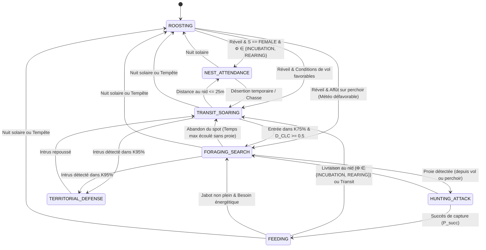

---
tags:
  - ibm
  - odd
  - raptor
  - bonelli
  - fsm
  - behavior
type: odd-spec
status: draft
---

# Spécification ODD : Cycle Comportemental et Ordonnancement

> **Liens internes :** [[ODD_Agent_Variables_Etat_et_Parametres]] | [[ODD_Agent_Cycle_Comportemental]] | [[ODD_Agent_Sous_Modeles_Biophysiques]] | [[Interface_Requise_Environnement]]

Cette fiche décrit l'emploi du temps d'un aigle et la manière dont il change d'activité (repos, vol, chasse, soin au nid) selon l'heure, la météo, son sexe et la saison. Elle fixe aussi l'ordre précis dans lequel l'oiseau observe son environnement, prend une décision et se déplace à chaque tour de simulation.

## 1. Mécanique Générique : Machine à États Finis (FSM) Journalière

L'agent évolue à travers 7 états comportementaux discrets $\Sigma$. Les probabilités et seuils de transition dépendent de l'heure solaire, de la météo locale, du sexe $S$, de l'expérience $Exp$ et de la phase phénologique $\Phi$.

---

## 2. Règles Algorithmiques et Conditions de Transition

### 2.1. Calendrier Phénologique Annuel (Transitions de Phase $\Phi$)
Les transitions de phase $\Phi$ s'appliquent au niveau du territoire/couple selon le jour julien $J \in [1, 365]$ :
1. **`PRE_BREEDING` (Parades et construction du nid) :** Débute au $J = 1$ (1er janvier) ou début de l'hiver, accouplements de janvier à mars jusqu'à la date de ponte $J_{lay}$ (février–mars).
2. **`INCUBATION` :** Si un œuf est pondu ($1\text{ à }2$ œufs, rarement $3$), $\Phi \leftarrow \text{INCUBATION}$ pour une durée de $37\text{ à }41\text{ jours}$ (moyenne $39\text{ jours}$) jusqu'à l'éclosion $J_{hatch}$ (avril–mai).
3. **`REARING` (Élevage des jeunes au nid) :** De $J_{hatch}$ jusqu'à l'envol $J_{fledge}$, durant $55\text{ à }65\text{ jours}$ (moyenne $63\text{ jours}$, envol fin mai à début juillet).
4. **`POST_FLEDGING` (Dépendance post-envol) :** De $J_{fledge}$ jusqu'au départ des jeunes en dispersion ($77\text{ à }113\text{ jours}$ après l'envol) ou jusqu'au 1er juillet pour l'analyse de l'effort parental.
5. **`NON_BREEDING` :** De juillet à décembre ($J \in [182, 365]$), ou toute l'année si $B_{stat} == \text{False}$.

### 2.2. Conditions de Transition Journalières (État $\Sigma$)

| Transition $\Sigma_t \rightarrow \Sigma_{t+1}$ | Condition Algorithmique Exacte | Paramètres Spécifiques (*Aquila fasciata*) |
| :--- | :--- | :--- |
| **`ROOSTING` $\rightarrow$ Actif** | $t_{day} \in [t_{sunrise} - 30\text{ min}, t_{sunrise} + 120\text{ min}]$ ET $Rain_t < Rain_{max}$ | Fenêtre d'éveil observée par télémétrie GPS ($-0.5\text{ h}$ à $+2\text{ h}$ après le lever du soleil). Démarre en `FORAGING_SEARCH` (affût) si météo défavorable, sinon en `TRANSIT_SOARING`. |
| **Actif $\rightarrow$ `ROOSTING`** | $t_{day} \ge t_{sunset} + 60\text{ min}$ OU $W_t > W_{storm}$ OU $Rain_t \ge Rain_{max}$ | Valable depuis `TRANSIT_SOARING`, `FORAGING_SEARCH` et `FEEDING`. En hiver, activité restreinte entre $08\text{h}00$ et $18\text{h}00$ ; en été entre $06\text{h}00$ et $21\text{h}00$. |
| **Maintien en `NEST_ATTENDANCE`** | $\|\vec{p} - \vec{p}_{nest}\| \le 25\text{ m}$ pendant $\Delta t_{away} < 10\text{ min}$ | **Asymétrie sexuelle forte :** En `INCUBATION`, la femelle assure quasi toute l'incubation ($\tau_{flight} = 0.19 \pm 0.13$, portée $1088\text{ m}$) tandis que le mâle chasse ($\tau_{flight} = 0.26 \pm 0.06$, portée $1892\text{ m}$). En `REARING`, la présence de la femelle au nid diminue progressivement dès que les poussins thermorégulent, et elle rejoint le mâle à la chasse ($\tau_{flight, F} = 0.24$, $\tau_{flight, M} = 0.27$). |
| **`TRANSIT_SOARING` $\rightarrow$ `FORAGING_SEARCH`** | Cellule courante $\in K_{75\%}$ ET $D_{CLC}(x,y) \ge 0.50$ | L'agent cible les "bons spots de chasse" (détectabilité $\ge 0.50$) situés dans la zone intermédiaire $K_{75\%}$. Chasse souvent coopérative (en tandem) entre partenaires du couple. |
| **`FORAGING_SEARCH` (Vol $\leftrightarrow$ Affût)** | $w_{uplift} < w_{min}$ OU $W_t \notin [2.5, 7.5]\text{ m}\cdot\text{s}^{-1}$ ET `perch_availability` $> 0$ | L'agent reste en `FORAGING_SEARCH` mais bascule en `flight_mode = PERCHED` pour économiser son énergie et favoriser l'attaque par surprise. |
| **`FORAGING_SEARCH` $\rightarrow$ `TRANSIT_SOARING`** | Temps de recherche sur spot $> t_{give\_up}$ sans détection `[À CALIBRER]` | Abandon du patch de chasse infructueux pour prospecter une autre cellule favorable de $K_{75\%}$. |
| **`FORAGING_SEARCH` $\rightarrow$ `HUNTING_ATTACK`** | Détection d'un groupe de proies ($G \ge 1$) dans $R_{detect}$ | L'attaque peut être lancée depuis un perchoir (`PERCHED`, mode favorisant la surprise) ou depuis le vol (`SOARING_GLIDING` / `FLAPPING`). |
| **`FEEDING` / Livraison au nid** | $C > 0$ ET $\Phi \in \{\text{INCUBATION}, \text{REARING}\}$ | Si $S == \text{MALE}$, le mâle transporte la proie et la livre à la femelle au nid ou à proximité immédiate (visite courte $< 1\text{ min}$ fréquente), et seule la femelle découpe et nourrit les jeunes. |
| **Tout état $\rightarrow$ `TERRITORIAL_DEFENSE`** | Présence d'un congénère non-partenaire dans $K_{95\%}$ | Comportement agonistique immédiat maintenant le chevauchement inter-territorial à $4.18\% \pm 3.06\%$. |
___

## 3. Ordonnancement d'un Pas de Temps $\Delta t$

Le pas de temps de référence de la boucle comportementale et cinématique est fixé à $\Delta t = 5\text{ minutes}$ ($300\text{ s}$) en période diurne (de $t_{sunrise} - 1\text{ h}$ à $t_{sunset} + 1\text{ h}$) et $\Delta t_{night} = 60\text{ minutes}$ la nuit, calqué sur la résolution des balises GPS/GSM haute fréquence.

À chaque pas de temps $t \rightarrow t + \Delta t$, chaque instance de `RaptorAgent` exécute séquentiellement :

1. **`perceive_environment(env, t)` :**
   - Lecture des variables météo locales ($W_t, T_t, Rain_t, w_{uplift}$) et des attributs de la cellule courante et des cellules voisines ($D_{CLC}, KBI$).
   - Détection des congénères voisins (calcul de l'intrusion territoriale) et des groupes de proies ($G$, couvert végétal dans un rayon de $20\text{ m}$).
2. **`update_behavioral_state()` :**
   - Évaluation de l'arbre de décision de la FSM selon l'état interne ($E, C, S, \Phi, Exp$) et les stimuli perçus.
   - Mise à jour de $\Sigma_t \rightarrow \Sigma_{t+1}$ et du mode de vol $M_{flight}$ (`PERCHED`, `SOARING_GLIDING`, `FLAPPING`).
3. **`execute_movement_and_action()` :**
   - Si $\Sigma_{t+1} \in \{\text{TRANSIT\_SOARING}, \text{FORAGING\_SEARCH}, \text{TERRITORIAL\_DEFENSE}\}$ : sélection de la cellule cible via la fonction de sélection de pas (SSF) et mise à jour de $(x, y, z)$, $L_{day}$, $\tau_{flight}$, $R_{day}$ et $St_{day}$.
   - Si $\Sigma_{t+1} == \text{HUNTING\_ATTACK}$ : tirage de Bernoulli du succès de capture $P_{succ}$. En cas de succès, incrémentation du jabot $C \leftarrow \min(C_{max}, C + m_{prey})$.
   - Si $\Sigma_{t+1} == \text{NEST\_ATTENDANCE}$ : incrémentation du temps de résidence au nid et transfert éventuel de biomasse du jabot vers la femelle ou la nichée.
4. **`update_energetics_and_memory()` :**
   - Calcul de la dépense énergétique $\Delta E_{out}$ (via $M_{flight}$ et $ODBA$) et de l'assimilation digestive $\Delta E_{in}$ depuis le jabot $C$.
   - Mise à jour de la carte de mémoire spatiale $\mathbf{M}(x, y)$ en fonction du succès de chasse et de l'ascendance rencontrée.